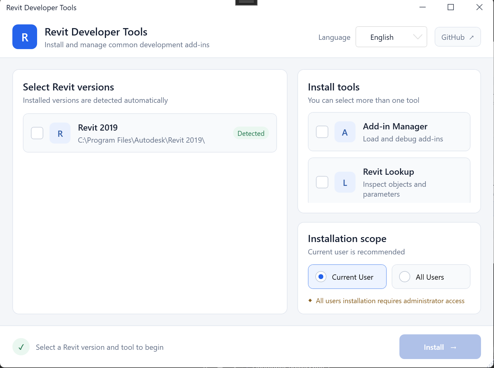

# Revit Developer Tools 🛠️

**中文** | [English](README_EN.md)

一款轻量级的 Revit 开发环境配置工具，用于快速安装常用的调试与对象查看插件。项目基于 .NET 8 和 WPF 开发，内置 Add-in Manager 与 RevitLookup，无需手动查找插件文件或编写 `.addin` 配置。


## ✨ 主要功能

- 🔍 **自动检测 Revit**：读取本机已安装的 Revit 版本及安装位置。
- 🧩 **安装 Add-in Manager**：快速加载和调试 Revit 插件，包含手动、无界面和只读模式。
- 🔎 **安装 RevitLookup**：查看 Revit 对象、属性、参数及 API 数据。
- 📦 **多版本批量安装**：可同时选择多个已检测到的 Revit 版本进行配置。
- 👤 **灵活的安装范围**：支持安装到当前用户或所有用户的 Add-Ins 目录。
- 🌐 **中英文界面**：可在中文与 English 之间切换。
- 📊 **安装状态反馈**：实时显示正在安装的工具、目标版本和安装结果。

## 🖼️ 界面预览



## ✅ 支持的 Revit 版本


> 内置的 Add-in Manager 与 RevitLookup 二进制文件目前适配 Revit 2016–2021。

## 🚀 使用方法

1. 启动 Revit Developer Tools。
2. 选择自动检测到的一个或多个 Revit 版本。
3. 勾选需要安装的 **Add-in Manager** 和/或 **RevitLookup**。
4. 选择安装范围：
   - **当前用户**：推荐，无需影响其他用户。
   - **所有用户**：需要管理员权限。
5. 点击“开始安装”，完成后重新启动对应版本的 Revit。

程序会自动生成 `.addin` 清单，并将对应版本的插件 DLL 写入 Revit Add-Ins 目录。

## 💻 开发与构建

### 环境要求

- Windows 10/11
- [.NET 8 SDK](https://dotnet.microsoft.com/download/dotnet/8.0)
- Revit 2016–2021（运行和验证插件时需要）

### 构建命令

在仓库根目录运行：

```powershell
dotnet restore Source/DevelopTools.sln
dotnet build Source/DevelopTools.sln -c Debug
dotnet run --project Source/DevelopToolsCore/DevelopToolsCore.csproj
```

发布前可执行 Release 构建：

```powershell
dotnet build Source/DevelopTools.sln -c Release
```

## 📁 项目结构

```text
Source/DevelopToolsCore/
├── ViewModels/       # 界面状态与安装逻辑
├── Models/           # Revit 产品及 Add-in 数据模型
├── Infrastructure/   # MVVM 绑定和命令基础设施
├── Languages/        # 中英文资源字典
└── Resources/        # 内置插件二进制资源
```

## ⚠️ 注意事项

- 建议优先使用“当前用户”安装，避免不必要的管理员权限请求。
- 安装前请关闭目标版本的 Revit，安装完成后再重新启动。
- “所有用户”安装会写入系统级 Add-Ins 目录，请以管理员身份运行本程序。
- 本工具用于简化 Revit 开发环境配置，内置插件的版权归其各自作者所有。

## 📄 License

本项目基于 [MIT License](LICENSE) 开源。
