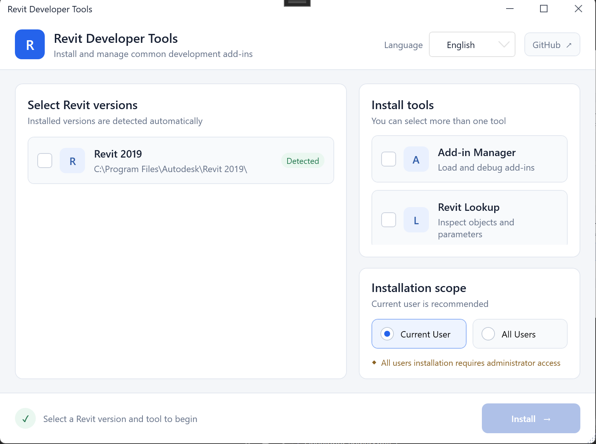

# Revit Developer Tools 🛠️

[中文](README.md) | **English**

A lightweight tool for configuring a Revit development environment and quickly installing commonly used debugging and object-inspection add-ins. Built with .NET 8 and WPF, it bundles Add-in Manager and RevitLookup so you do not need to locate plug-in files or create `.addin` manifests manually.


## ✨ Features

- 🔍 **Automatic Revit detection**: Detects locally installed Revit versions and their installation paths.
- 🧩 **Add-in Manager installation**: Helps load and debug Revit add-ins with manual, faceless, and read-only modes.
- 🔎 **RevitLookup installation**: Inspects Revit objects, properties, parameters, and API data.
- 📦 **Multi-version installation**: Installs the selected tools for multiple detected Revit versions at once.
- 👤 **Flexible installation scope**: Installs add-ins for the current user or all users.
- 🌐 **Bilingual interface**: Switches between Chinese and English.
- 📊 **Installation status**: Displays the tool being installed, its target Revit version, and the result.

## 🖼️ Preview



## ✅ Supported Revit Versions


> The bundled Add-in Manager and RevitLookup binaries currently support Revit 2016–2021.

## 🚀 Usage

1. Launch Revit Developer Tools.
2. Select one or more automatically detected Revit versions.
3. Select **Add-in Manager**, **RevitLookup**, or both.
4. Choose the installation scope:
   - **Current User**: Recommended and does not affect other users.
   - **All Users**: Requires administrator privileges.
5. Click **Install**, then restart the corresponding Revit versions after installation finishes.

The application automatically generates `.addin` manifests and writes the appropriate plug-in DLLs to the Revit Add-Ins directories.

## 💻 Development and Build

### Requirements

- Windows 10/11
- [.NET 8 SDK](https://dotnet.microsoft.com/download/dotnet/8.0)
- Revit 2016–2021 for running and validating the add-ins

### Build Commands

Run the following commands from the repository root:

```powershell
dotnet restore Source/DevelopTools.sln
dotnet build Source/DevelopTools.sln -c Debug
dotnet run --project Source/DevelopToolsCore/DevelopToolsCore.csproj
```

For a Release build, run:

```powershell
dotnet build Source/DevelopTools.sln -c Release
```

## 📁 Project Structure

```text
Source/DevelopToolsCore/
├── ViewModels/       # UI state and installation logic
├── Models/           # Revit product and add-in data models
├── Infrastructure/   # MVVM binding and command infrastructure
├── Languages/        # Chinese and English resource dictionaries
└── Resources/        # Bundled add-in binary resources
```

## ⚠️ Notes

- Installing for the current user is recommended to avoid unnecessary administrator permission requests.
- Close the target Revit versions before installation and restart them after installation finishes.
- Installing for all users writes to the system-wide Add-Ins directories, so run this application as an administrator.
- This tool simplifies Revit development environment setup. The bundled add-ins remain the property of their respective authors.

## 📄 License

This project is licensed under the [MIT License](LICENSE).
